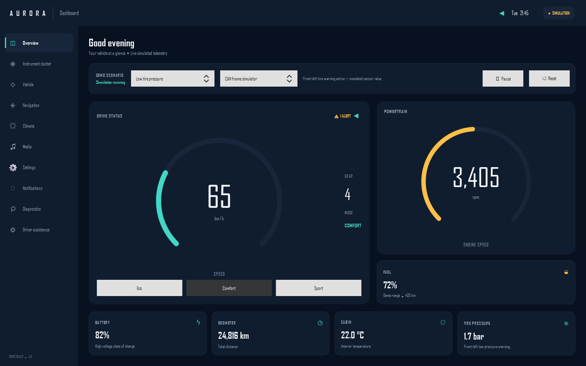
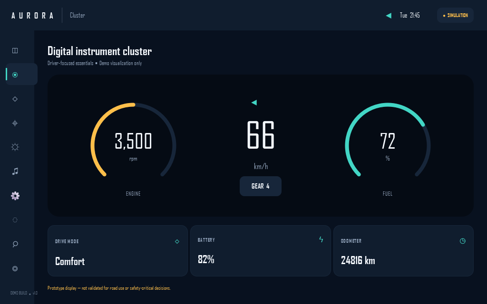
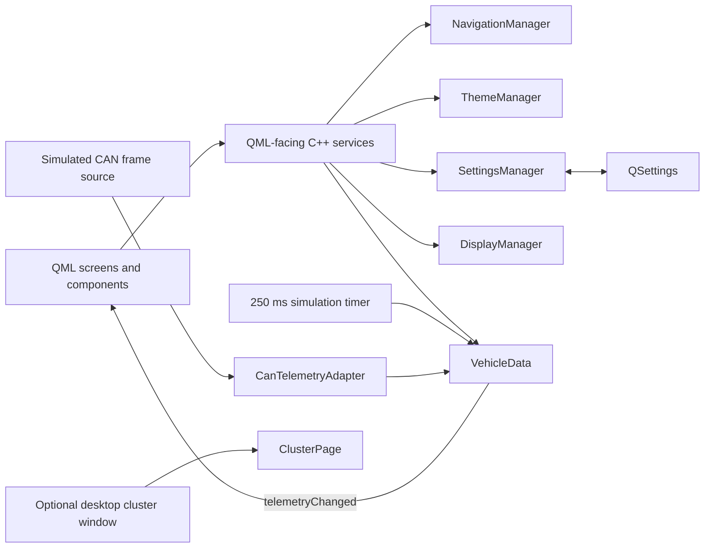

# Aurora Automotive HMI

I started Aurora Automotive HMI to improve my Qt/QML and C++ skills while exploring how an automotive-style HMI can be structured.

The app is a desktop simulation: C++ services generate vehicle-like telemetry, and QML presents it across a set of screens. A second, explicitly simulated CAN-frame source can feed the same vehicle-data model. Building it has given me practice connecting QML to C++ with properties and signals, organizing reusable UI components, and testing service and UI behavior.

> **This is a learning project, not vehicle software.** It does not connect to a real vehicle and has not been validated for driving or safety-critical use. All telemetry, warnings, route graphics, and driver-assistance visuals are illustrative.

This project is distributed under the [MIT License](./LICENSE).

## What is implemented

- **Dashboard:** simulated speed, RPM, fuel, battery state of charge, gear, odometer, cabin temperature, tire pressure, and drive mode.
- **Repeatable demo scenarios:** normal drive, low fuel, low front-left tire pressure, and hot cabin. Select a scenario, pause or resume the simulation, or reset it to its starting values. The modeled warnings appear on the dashboard, Diagnostics page, and Notification Center.
- **Eleven screens, including a timed splash:** dashboard, digital instrument-cluster view, vehicle information, navigation mock-up, climate mock-up, media mock-up, settings, notifications, diagnostics, and an ADAS concept view.
- **Simulated CAN-frame path:** an in-process generator emits a fixed-format, 12-byte frame with identifier `0x180`; a separate adapter validates the identifier, payload length, and decoded ranges before applying telemetry to `VehicleData`. This is a local software simulation, not CAN Bus Integration: there is no hardware interface, SocketCAN connection, or vehicle-bus connection.
- **Diagnostics mock-up:** shows the selected demo source, frame validity and counters, age of the latest valid frame, and scenario threshold warnings. Simulated CAN data is marked stale after one second without a valid frame. This does not read diagnostic trouble codes or report real vehicle faults.
- **Settings:** locally stored theme, unit preference, notification preference, volume, and desktop cluster-window preference, using `QSettings`.
- **Desktop display preview:** an optional secondary cluster window can be assigned to a display reported by Qt's desktop screen API. Its selected display is stored locally, and the window is centered and sized to fit that display's available area. Settings also provide two virtual target sizes for exercising window resizing on a single screen; this does not emulate separate Qt screens. Full multi-display support is not implemented, and physical multi-monitor behavior has not been tested.
- **Screen transitions and sizing:** navigation uses a `StackView` with short fade transitions. The sidebar and cluster/settings pages adapt to the app's supported compact desktop window size.
- **C++ services:** QML-facing navigation, theme, settings, and vehicle-data objects with `Q_PROPERTY` and signals. A Qt message handler writes to stderr and an application-local log file.
- **Reusable QML components:** gauges, metric cards, and section titles.
- **Automated tests:** Qt service tests cover navigation, theme changes, settings persistence and volume limits, drive-mode validation, scenario warnings, simulation controls, CAN-frame decoding/rejection, stale-frame detection and recovery, and telemetry ranges. QML tests cover screen navigation, warning bindings, display discovery, virtual target-size selection, the secondary window, and tolerant screenshot comparisons for the dashboard, diagnostics, and compact cluster layouts.
- **Android packaging workflow:** a GitHub Actions workflow is configured to build a generic Android debug ARM64 APK with Qt 6.8.3. It has not yet been run in this repository's GitHub Actions environment and does not provide Android Automotive support.

The navigation screen draws an illustrative route; it does not calculate routes. Climate controls change local demo state and do not control HVAC. The media controls do not play audio. The ADAS screen is a static illustration, not a sensor simulation. The CAN-frame simulator has no connection to SocketCAN, a USB adapter, a vehicle network, or a hardware CAN controller.

The demo CAN payload stores speed in 0.1 km/h units and RPM as little-endian 16-bit integers, followed by fuel and battery percentages, signed cabin temperature, four tire pressures in 0.1 bar units, and a gear index. This encoding is defined only for the local simulator; it is not based on a vehicle DBC or an OEM signal specification.

## Screenshots and demo

### Dashboard



### Instrument cluster



### Screen recording

[Watch the 14-second recording of the earlier demo UI](./demo/aurora-hmi-demo.mp4). It predates the CAN simulator and Diagnostics page.

## What I learned

- Connecting C++ objects to QML bindings with `Q_PROPERTY`, `NOTIFY` signals, and invokable methods.
- Keeping navigation, theme, settings, and simulated telemetry in separate C++ services.
- Building a common QML shell with reusable components and a `StackView` of screens.
- Making warning demonstrations repeatable and testing service behavior with Qt Test.
- Being explicit about the boundary between a visual simulation and a real vehicle interface.

One design trade-off in this prototype is that telemetry properties share a single `telemetryChanged` notification. This keeps the simulator API small, but a production model would need measured update rates and more deliberate notification granularity.

## How the code is organized



`main.cpp` creates the service objects, registers them with the `Auto.HMI` QML module, and loads the main QML view. Navigation, theme, settings, display selection, vehicle data, and CAN adapter diagnostics are C++ `QObject`s exposed to QML as singleton instances. `VehicleData` runs its internal timer by default and emits `telemetryChanged`; when the CAN-frame simulator is selected, its frames pass through `CanTelemetryAdapter` before updating that same model. The adapter tracks time since the last valid frame and marks the simulated signal stale after one second; a new valid frame restores its valid state. Scenario and threshold-warning logic remains local to the simulation.

Both local data sources run at 4 Hz, which is enough for this desktop demo but is not a production instrument-cluster update rate. Unit conversions currently live in QML bindings, and the shared telemetry signal notifies all telemetry-bound properties together. The QML screenshot tests compare downscaled dashboard, diagnostics, and compact-cluster captures against checked-in references with a mismatch tolerance; they are intended to catch large visual changes, not pixel-perfect rendering differences across platforms. These choices would need revisiting in a real vehicle-data model.

## Build, run, and test

Requirements: CMake 3.21 or newer, a C++17 compiler, and Qt 6.5 or newer with the **Gui**, **Quick**, **Quick Controls**, and **Test** components.

For a Qt installation available through `CMAKE_PREFIX_PATH`:

```sh
cmake -S . -B build -DCMAKE_PREFIX_PATH=<Qt-install-prefix>
cmake --build build
ctest --test-dir build --output-on-failure
```

For MSYS2 UCRT64, this repository includes a configure preset:

```powershell
cmake --preset msys2-ucrt64
cmake --build build/mingw-ucrt64 --parallel 4
.\build\mingw-ucrt64\auto-hmi.exe
.\build\mingw-ucrt64\auto-hmi.exe --virtual-displays
.\build\mingw-ucrt64\auto-hmi-tests.exe -v1
.\build\mingw-ucrt64\auto-hmi-qml-tests.exe -v1
```

The MSYS2 preset currently uses `C:\msys64` for the compiler, Ninja, and Qt paths. Update those paths in `CMakePresets.json` if MSYS2 is installed elsewhere. The project was built with Qt 6.12 and MinGW UCRT64. Run both registered tests with `ctest --test-dir build/mingw-ucrt64 --output-on-failure`.

The Android workflow uses Qt 6.8.3, the Android ARM64 Qt kit, Android SDK 35, and NDK 26.1.10909125 to package a debug APK using Qt's generated `auto-hmi_make_apk` target. It has not been validated by a hosted workflow run or on an Android device. An Android APK build is not evidence of Android Automotive OS compatibility or approval for in-vehicle use.

## Project structure

```text
.
├── .github/
│   └── workflows/
│       ├── android-build.yml
│       └── build.yml
├── .vscode/
│   └── settings.json
├── .gitignore
├── CMakeLists.txt
├── CMakePresets.json
├── LICENSE
├── README.md
├── demo/
│   ├── aurora-hmi-demo.mp4
│   ├── cluster.png
│   └── dashboard.png
├── qml/
│   ├── Main.qml
│   ├── components/
│   │   ├── Gauge.qml
│   │   ├── MetricCard.qml
│   │   └── SectionTitle.qml
│   └── pages/
│       ├── ADASPage.qml
│       ├── ClimatePage.qml
│       ├── ClusterPage.qml
│       ├── DashboardPage.qml
│       ├── DiagnosticsPage.qml
│       ├── InstrumentClusterWindow.qml
│       ├── MediaPage.qml
│       ├── NavigationPage.qml
│       ├── NotificationsPage.qml
│       ├── SettingsPage.qml
│       ├── SplashPage.qml
│       └── VehicleInfoPage.qml
├── src/
│   ├── app_logger.{h,cpp}
│   ├── can_simulation.{h,cpp}
│   ├── display_manager.{h,cpp}
│   ├── main.cpp
│   ├── navigation_manager.{h,cpp}
│   ├── settings_manager.{h,cpp}
│   ├── theme_manager.{h,cpp}
│   └── vehicle_data.{h,cpp}
└── tests/
    ├── baselines/
    │   ├── cluster.png
    │   ├── dashboard.png
    │   └── diagnostics.png
    ├── tst_qml.cpp
    └── tst_services.cpp
```

## Future Improvements

The following are planned ideas, not implemented features:

- **CAN Bus Integration:** connect through a real or virtual CAN interface and define a documented vehicle signal mapping. The current 12-byte CAN-frame format is generated locally and is not an OEM or DBC protocol.
- **Android Automotive Support:** investigate and validate a dedicated Android Automotive OS build and deployment. The configured generic Android APK workflow is not an Android Automotive target and has not been run.
- **AUTOSAR Integration:** explore integration with an AUTOSAR Classic or Adaptive environment; none is present in this project.
- **SOME/IP Communication:** add a SOME/IP service/client path; no SOME/IP communication exists currently.
- **OTA Updates:** design an update workflow; no update, signing, or deployment mechanism is implemented.
- **Advanced ADAS Features:** develop a simulated sensor/perception and warning flow. The current ADAS screen is a static illustration with fixed example values, not an ADAS simulation.
- **Voice Assistant Integration:** add a voice interaction prototype; no speech recognition or assistant interface is implemented.
- **Multi-display Support:** extend the desktop preview into a tested multi-display experience. The current optional cluster window and virtual target sizes do not emulate separate displays or establish multi-display support.
- Expand screenshot regression coverage beyond the dashboard, diagnostics, and cluster screens, and check its tolerances on more platforms.
- Consider adding source-loss handling to the internal timer-based simulator; the current one-second freshness timeout applies only to the simulated CAN-frame source.

The navigation screen does not calculate routes, climate controls do not operate HVAC, media controls do not play audio, and diagnostics do not read vehicle trouble codes. No real vehicle connectivity, AUTOSAR, SOME/IP, OTA, voice assistant, ADAS sensing, or Android Automotive OS deployment is included. This project has not been validated for driving or safety-critical use, and no safety or regulatory certification is claimed.

## About me

I’m interested in automotive software, embedded systems, Qt/QML development, and cybersecurity. This project is part of my ongoing learning in those areas.
